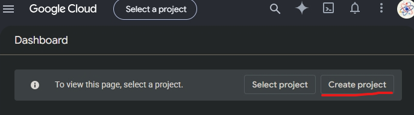
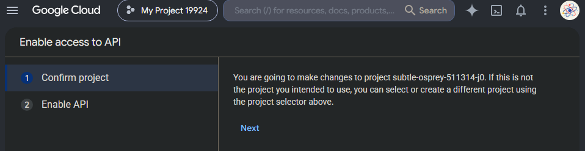
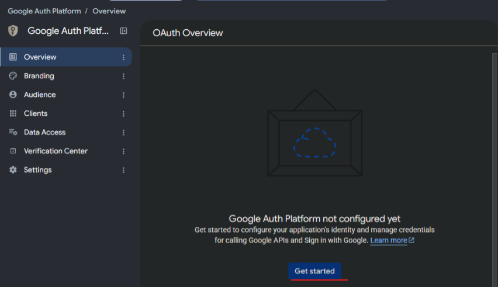
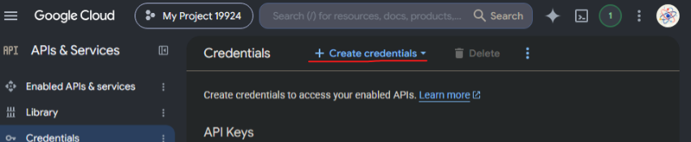

# Gửi email Hello World bằng Gmail API

Script `send&recieve.py` gửi một email text đơn giản bằng Gmail API và OAuth 2.0. Lần chạy đầu sẽ mở trình duyệt để cấp quyền; các lần sau dùng token đã lưu trong `token.json`.

## Requirements

- Python 3.10 trở lên.
- Một tài khoản Gmail có quyền gửi email.
- Một Google Cloud project đã bật Gmail API.
- OAuth 2.0 Desktop App client JSON, lưu tại `credentials.json`.
- Trình duyệt để hoàn tất OAuth ở lần chạy đầu tiên.

## 1. Tạo Google Cloud project và bật Gmail API

1. Tạo hoặc chọn project tại [Google Cloud Console](https://console.cloud.google.com/projectselector/home/dashboard).



2. Bật Gmail API tại [Enable Gmail API](https://console.cloud.google.com/flows/enableapi?apiid=gmail.googleapis.com).



3. Cấu hình OAuth consent screen tại [Google Auth Platform](https://console.cloud.google.com/auth/overview). Chọn **External** nếu tài khoản không thuộc Google Workspace của bạn, thêm email test ở mục **Audience/Test users**.



4. Tạo OAuth client tại [Credentials](https://console.cloud.google.com/apis/credentials): chọn **Create Credentials** -> **OAuth client ID** -> **Desktop app**.



5. Tải JSON về, đổi tên thành `credentials.json`, đặt vào thư mục `script/`.

Tài liệu chính thức:

- [Gmail API Python quickstart](https://developers.google.com/gmail/api/quickstart/python)
- [Gmail API: gửi email](https://developers.google.com/gmail/api/guides/sending)
- [OAuth 2.0 cho ứng dụng desktop](https://developers.google.com/identity/protocols/oauth2/native-app)

## 2. Tạo môi trường ảo và cài dependency

Từ thư mục gốc repository, tạo một môi trường ảo riêng cho script:

```bash
python3 -m venv .venv
source .venv/bin/activate # Linux
.venv/Scripts/Activate.ps1 # Windows
python -m pip install -r requirements.txt
```

Sau khi kích hoạt môi trường ảo, chạy script từ thư mục `script`:

## 3. Gửi email

```bash
python -m "script.send&recieve" send nguoi-nhan@example.com
```

Tuỳ chỉnh subject và nội dung:

```bash
python -m "script.send&recieve" send nguoi-nhan@example.com \
  --subject "Test Gmail API" \
  --body "Hello World từ Gmail API"
```

Lần đầu đăng nhập, chọn tài khoản Gmail gửi thư và chấp nhận quyền gửi email. Nếu Google hiện cảnh báo ứng dụng chưa được xác minh, chỉ tiếp tục khi đây là project của bạn và tài khoản đã được thêm vào danh sách test users.
